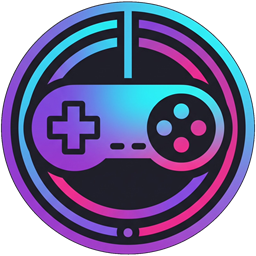

<p align="center">
  
</p>

<h1 align="center">Controllarr</h1>

<p align="center">
  <strong>The automated ROM library manager and acquisition engine for retro and modern game consoles.</strong>
</p>

<p align="center">
  <a href="LICENSE.md"></a>
  <a href="https://dotnet.microsoft.com/"></a>
  <a href="https://react.dev/"></a>
  <a href="https://github.com/12thirtyfour/Controllarr/wiki"></a>
  <a href="https://github.com/12thirtyfour/Controllarr/actions"></a>
</p>

---

> 📖 **Full Documentation**: Explore the [**Controllarr Wiki**](https://github.com/12thirtyfour/Controllarr/wiki) for in-depth setup guides, console platform compatibility, BIOS matrices, virtual symlink libraries, and hardware exporter profiles. Track release history in [**CHANGELOG.md**](CHANGELOG.md) and active/upcoming milestones in [**ROADMAP.md**](ROADMAP.md).

---

## What is Controllarr?

**Controllarr** brings the effortless, automated library management experience made famous by media managers like Sonarr and Radarr to your video game collection.

Instead of wrestling with disorganized folders, unverified dumps, multi-region duplicates, missing BIOS files, or manually copying games to flash carts and handhelds, Controllarr automates the entire lifecycle:

1. **Pick Your Consoles**: Manage cartridge, disc, and handheld systems across all generations.
2. **Find & Acquire**: Automatically search and grab titles across direct HTTP archives (Internet Archive), Usenet (Newznab), and BitTorrent (Torznab).
3. **Verify Every Byte**: Check dumps against cross-referenced **No-Intro**, **Redump**, **TOSEC**, **SmokeMonster HTGDB/SMDB**, **FBNeo / Neo Geo AES**, and **NSWDB** hash databases (`SHA-256`, `SHA-1`, `MD5`, `CRC32`), automatically holding unverified downloads in the Activity Queue.
4. **Flexible Library Curation**: Maintain either a streamlined **1G1R (One Game, One ROM)** set (per-game or per-region) using drag-and-drop region ordering, or a full **Completionist** collection tracking all documented revisions, regional variants, prototypes, betas, and aftermarket releases.
5. **Sync to Hardware**: Export curated sets, media artwork, and `gamelist.xml` manifests formatted specifically for flash carts, ODEs, and handhelds (EverDrive, MiSTer FPGA, Analogue Pocket, OnionOS, etc.).
6. **Play Instantly**: Launch games directly in your browser with embedded Libretro cores or hand off to native desktop emulators with a single click.

---

## Highlights

Detailed feature breakdowns and technical documentation are available in the [**Controllarr Wiki**](https://github.com/12thirtyfour/Controllarr/wiki):

* **[🎯 Flexible Library & Collection Curation](https://github.com/12thirtyfour/Controllarr/wiki/Core-Concepts)**: Full control to define the exact type of library you want to maintain—whether a streamlined **1G1R (One Game, One ROM)** set (per-game or per-region) with custom drag-and-drop region ordering, or a **Completionist** collection tracking all documented revisions, regional variants, prototypes, betas, and aftermarket releases, alongside unified path naming and virtual symlink libraries.
* **[🛡️ Canonical Hash Verification, Scheduled DAT Auto-Updates & Romhack Patcher](https://github.com/12thirtyfour/Controllarr/wiki/Ingestion-and-Hash-Verification)**: Validates CRC32, MD5, SHA-1, and SHA-256 checksums on ingestion against daily-updated, cross-referenced No-Intro (including 3-way `Not Encrypted` / `Encrypted` / `Both` NDS/3DS preferences), Redump, TOSEC, SmokeMonster HTGDB/SMDB, FBNeo Neo Geo, and NSWDB catalogs, holding unverified automated downloads in the Activity Queue, and includes a built-in `.ips` / `.bps` / `.xdelta` Romhack & Translation Patching Pipeline that applies patches non-destructively onto verified retail base ROMs.
* **[🎨 Priority-Cascading Metadata Scrapers](https://github.com/12thirtyfour/Controllarr/wiki/Ingestion-and-Hash-Verification)**: Configure priority order (`1..4`), API rate-limit fail-safes, and per-scraper artwork checkboxes across **ScreenScraper**, **IGDB**, **TheGamesDB**, and **Libretro / LaunchBox** to complete missing box art, screenshots, clear logos, video previews, manuals, and EmulationStation `gamelist.xml` manifests without overwriting existing files.
* **[🗂️ Virtual Symlink Libraries](https://github.com/12thirtyfour/Controllarr/wiki/Hardware-Target-Exporter)**: Maintain live, non-destructive symlinked/junctioned folder structures formatted for MiSTer FPGA, RetroArch, Analogue Pocket, OnionOS, Batocera, and ES-DE without duplicating ROM files.
* **[💾 Hardware Target Exporter (HTGDB / SMDB)](https://github.com/12thirtyfour/Controllarr/wiki/Hardware-Target-Exporter)**: One-click SD card exports with automatic FAT32-safe alphabetical bucketing (`A-M/`, `N-Z/`) for MiSTer, Analogue Pocket, OnionOS, EverDrive, and ODEs.
* **[🕹️ Platform BIOS Files & Downloader](https://github.com/12thirtyfour/Controllarr/wiki/Platform-BIOS-Matrix)**: Inspect, checksum, and automatically download/verify 80+ required system firmwares across 29 platforms directly from **Library -> BIOS Files** or each platform's overview page.
* **[🏆 RetroAchievements Integration](https://github.com/12thirtyfour/Controllarr/wiki/In-Browser-Play-and-Emulators)**: Showcase your gaming badges, progression, and leaderboard statistics directly in your library.
* **[🎮 Play Anywhere](https://github.com/12thirtyfour/Controllarr/wiki/In-Browser-Play-and-Emulators)**: Embedded WebAssembly Libretro player for instant browser gaming, plus one-click protocol launcher (`controllarr://play/{gameId}`) for native desktop emulators.
* **[📦 Automated Archive Ingestion & Compression](https://github.com/12thirtyfour/Controllarr/wiki/Ingestion-and-Hash-Verification)**: Extracts `.zip`, `.7z`, and `.rar` sets, and losslessly converts disc images into compressed `.chd` (via `chdman`) and `.rvz` (via `dolphin-tool`).
* **[🔍 3-Way Acquisition Priority & Live HTTPS Queue](https://github.com/12thirtyfour/Controllarr/wiki/Acquisition-and-Indexers)**: Search and stream across public HTTP archives (Internet Archive S3 API with live Activity Queue speed & import history), Usenet (Newznab gaming categories `1000` & `8000`), and BitTorrent (Torznab).

---

## Universal Console Scope

Controllarr is dedicated specifically to video game consoles, handhelds, and hardware expansion systems across every generation:

* **Nintendo**: NES, Famicom Disk System, SNES, N64, GameCube, Wii, Wii U, Switch, Game Boy, GBC, GBA, DS, 3DS, Virtual Boy.
* **Sega**: SG-1000, Master System, Genesis / Mega Drive, Sega CD, Sega 32X, Saturn, Dreamcast, Game Gear.
* **Sony**: PlayStation (PS1), PlayStation 2 (PS2), PlayStation 3 (PS3), PSP, PlayStation Vita.
* **Microsoft**: Xbox, Xbox 360.
* **NEC & SNK**: TurboGrafx-16 / PC Engine, PC Engine CD-ROM², PC-FX, Neo Geo AES/MVS, Neo Geo CD, Neo Geo Pocket.
* **Classic & Others**: Atari (2600 through Jaguar), 3DO, Philips CD-i, Bandai WonderSwan, ColecoVision, Intellivision, Vectrex.

*(Note: Controllarr focuses exclusively on dedicated console and handheld hardware; computer architectures and arcade sets are excluded. See the full [Supported Consoles Matrix](https://github.com/12thirtyfour/Controllarr/wiki/Supported-Consoles) for file extension and compression specifications).*

---

## Architecture

Controllarr is built as a high-performance client-server application:

```
┌────────────────────────────────────────────────────────┐
│               React 19 / TypeScript SPA                │
│       Vite • React Query • React-Table • FontAwesome    │
└───────────────────────────┬────────────────────────────┘
                            │ REST API (v3 / v5) + SignalR
┌───────────────────────────▼────────────────────────────┐
│                    Controllarr Core                    │
│             ASP.NET Core (.NET 10.0 Runtime)           │
├────────────────────────────────────────────────────────┤
│ • Curation Engine (1G1R / Completionist)                  │
│ • DAT Catalog Ingestion (No-Intro/Redump/TOSEC)           │
│ • HTGDB/SMDB Exporter  • Hash Verifier (CRC32/MD5/SHA1)│
│ • BIOS Matrix Service  • Disc Compressor (CHD/RVZ)     │
│ • 3-Way Search Dispatch (HTTP / Usenet / Torznab)      │
├───────────────────────────┬────────────────────────────┤
│   SQLite (Default)        │   PostgreSQL (Enterprise)  │
└───────────────────────────┴────────────────────────────┘
```

* **Backend**: ASP.NET Core on **.NET 10**, compiled with StyleCop compliance and zero-warning enforcement (`<TreatWarningsAsErrors>true`).
* **Frontend**: React 19 single-page application built with **TypeScript**, **Vite**, and modernized styling.
* **Persistence Layer**: Dual-database abstraction supporting embedded **SQLite** out-of-the-box or external **PostgreSQL** (versions 16–18).
* **REST API**: Dual-exposed OpenAPI endpoints on both `/api/v3` and `/api/v5`.
* **Default Port**: `7050`.

---

## Quick Start

### Prerequisites
* [.NET 10.0 SDK](https://dotnet.microsoft.com/download/dotnet/10.0)
* [Node.js](https://nodejs.org/) (v20+ or v24+) & [Yarn](https://yarnpkg.com/)
* Supported OS: macOS (Apple Silicon / Intel), Linux (x64 / ARM64), or Windows (x64).

### Build & Run
```bash
# 1. Clone the repository
git clone https://github.com/12thirtyfour/Controllarr.git
cd Controllarr

# 2. Build the React frontend
yarn install
yarn build

# 3. Build the .NET backend
dotnet build src/Sonarr.sln --configuration Release

# 4. Launch Controllarr
# macOS / Linux:
./_output/net10.0/Controllarr --nobrowser

# Windows:
.\_output\net10.0\Controllarr.Console.exe --nobrowser
```

Open your browser and navigate to **[http://localhost:7050](http://localhost:7050)**.

### Docker & Docker Compose
```yaml
services:
  controllarr:
    image: ghcr.io/12thirtyfour/controllarr:latest
    build: .
    container_name: controllarr
    environment:
      - PUID=1000
      - PGID=1000
      - UMASK=002
      - TZ=America/Chicago
    ports:
      - "7050:7050"
    volumes:
      - ./config:/config
      - ./roms:/roms
      - ./downloads:/downloads
    restart: unless-stopped
```
```bash
docker compose up -d --build
```

*(For reverse proxies, systemd services, or multi-architecture container builds, see the [Installation Guide](https://github.com/12thirtyfour/Controllarr/wiki/Installation-Guide) and [Quick Start Tutorial](https://github.com/12thirtyfour/Controllarr/wiki/Quick-Start)).*

---

## Credits, Upstream Attribution & Licenses

Controllarr is open-source software licensed under the [GNU General Public License v3.0 (GPL-3.0)](LICENSE.md).

We stand on the shoulders of incredible open-source projects, preservation databases, and emulation communities. Detailed notices are in [THIRD_PARTY_NOTICES.md](THIRD_PARTY_NOTICES.md):

* **[Sonarr](https://github.com/Sonarr/Sonarr)** (**GPL-3.0**) — Upstream media management foundation from which Controllarr was forked.
* **[Hardware Target Game Database (HTGDB / SMDB)](https://github.com/frederic-mahe/Hardware-Target-Game-Database)** & **[SmokeMonster EverDrive-Packs-Lists-Database](https://github.com/SmokeMonsterPacks/EverDrive-Packs-Lists-Database)** — Flash-cart directory layouts, SHA-256 SMDB manifests, and curation schemas by SmokeMonster and Frédéric Mahé.
* **[No-Intro](https://www.no-intro.org/)**, **[Redump](http://redump.org/)**, **[TOSEC](https://www.tosecdev.org/)**, **[FinalBurn Neo (`FBNeo`)](https://github.com/finalburnneo/FBNeo)**, **[NSWDB](http://nswdb.com/)**, & **[Libretro Database](https://github.com/libretro/libretro-database)** — Canonical ROM and optical disc checksum databases.
* **[IGDB](https://www.igdb.com/)**, **[ScreenScraper.fr](https://www.screenscraper.fr/)**, **[TheGamesDB](https://thegamesdb.net/)**, **[Libretro Thumbnails](https://github.com/libretro-thumbnails/libretro-thumbnails)**, & **[LaunchBox Games Database](https://gamesdb.launchbox-app.com/)** — Video game metadata, manuals, video previews, and high-resolution artwork providers.
* **[Internet Archive (`archive.org`)](https://archive.org/)** — Public preservation collections and system firmware verification.
* **[RetroAchievements](https://retroachievements.org/)** — Achievement metadata and community badge services.
* **[Libretro / RetroArch](https://github.com/libretro/RetroArch)** & **[EmulatorJS](https://github.com/EmulatorJS/EmulatorJS)** (**GPL-3.0**) — In-browser WebAssembly emulation cores, shaders, and desktop launch targets.
* **`chdman` / [MAME Project](https://github.com/mamedev/mame)** — Optical disc compression into `.chd`.
* **`dolphin-tool` / [Dolphin Project](https://github.com/dolphin-emu/dolphin)** — GameCube & Wii `.rvz` disc compression.
* **[Evan-Amos](https://commons.wikimedia.org/wiki/User:Evan-Amos) ([Vanamo Media](https://github.com/evan-amos))** — High-resolution public-domain (CC0) console hardware photography.

---

## Project Disclaimer & Development Model

> [!NOTE]
> **Experimental AI-Native Development Experiment**  
> Controllarr is both an active passion project and an AI-driven software engineering experiment. The project owner has no professional coding experience. Other than the upstream open-source foundation provided by Sonarr, all architectural design, backend C#/.NET 10 development, frontend React/TypeScript UI, and refactoring from the initial fork onward have been designed and implemented autonomously through artificial intelligence:
>
> * **Project Owner**: Human visionary, direction, functional requirements, and physical hardware verification.
> * **Gemini**: Project manager, requirements evaluator, and system architect.
> * **Jules**: Feature engineer and autonomous developer.
> * **Antigravity**: Lead engineering agent, pair programmer, CI/CD triage specialist, and release steward.
